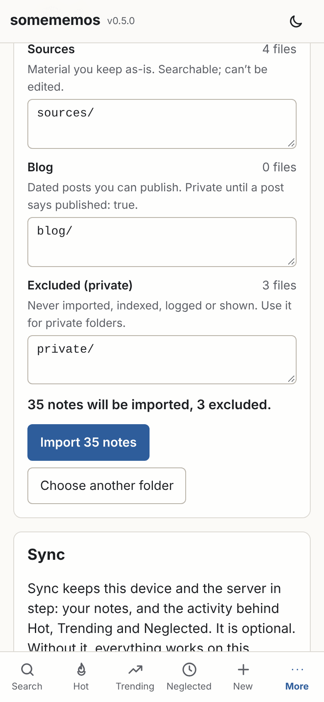
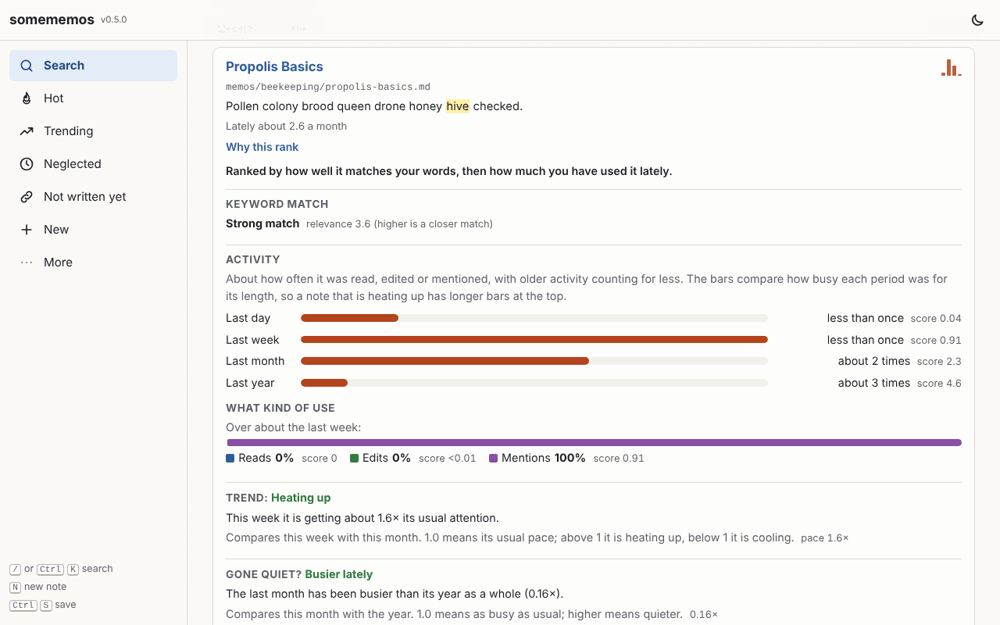
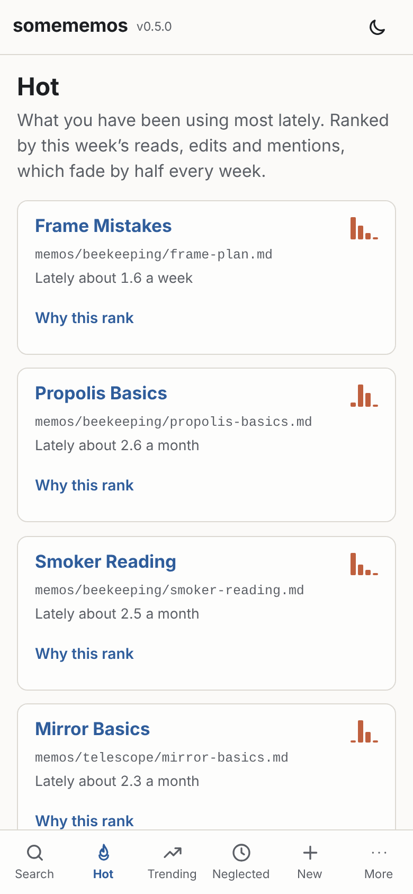
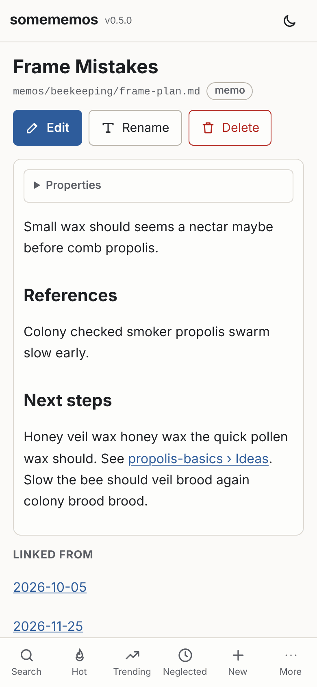
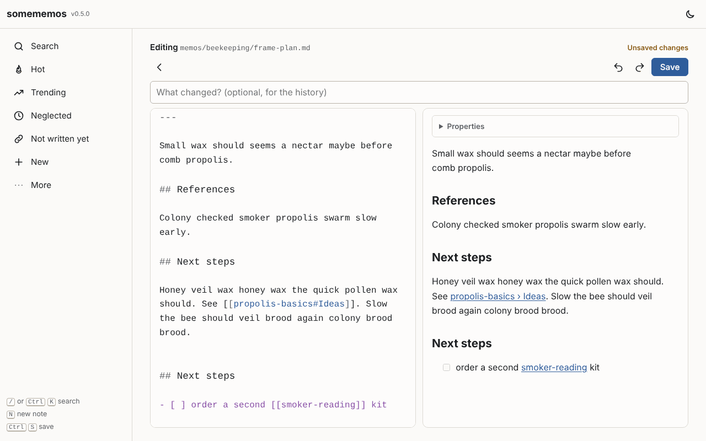
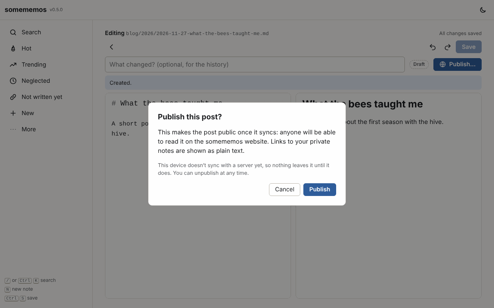
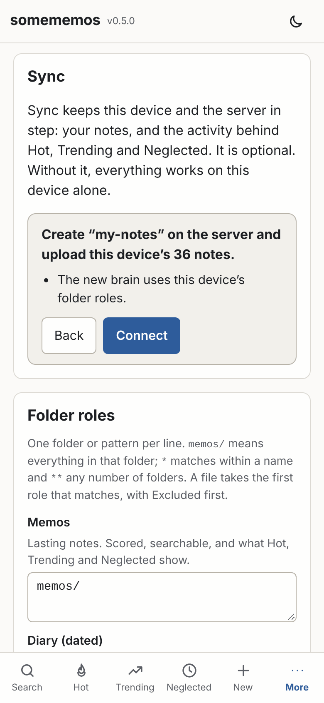
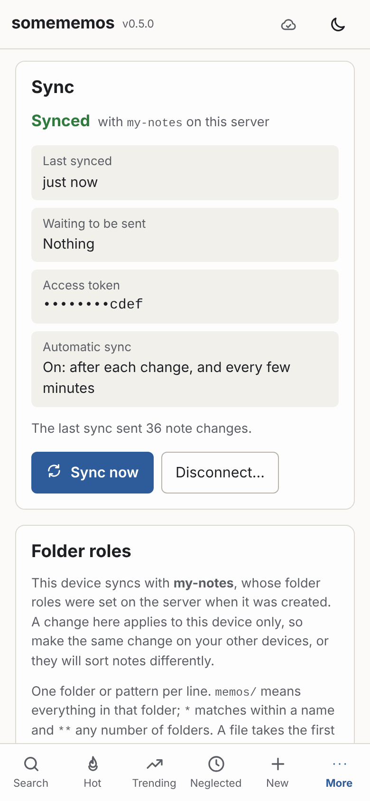

# The web app

The web app is somememos for people: an installable app for a phone or a desktop browser that keeps your whole brain on the device. Search, the hot, trending and neglected views, reading and editing all work with no network. Connecting to a server is optional and adds sync between devices and a public blog.

The screenshots on this page show an invented brain.

## Getting the app

The app is served by the somememos server, or by the same build run on its own (`npm run build && node apps/web/build` from a checkout; see [server.md](server.md#running-it-locally)). **Nothing is hosted publicly yet**, so today you open it from a server you run. Without a database the build serves the app alone, and everything except sync works.

To install it so it opens from the home screen or dock like any other app:

- **Chrome or Edge on a desktop:** open the app and choose the install icon in the address bar (or the browser menu's "Install somememos").
- **Chrome on Android:** the browser menu's "Install app" or "Add to Home screen".
- **Safari on iPhone or iPad:** Share, then "Add to Home Screen" (untested; see [Browser requirements](#browser-requirements)).

Installing needs the app to be served over HTTPS (or from `localhost`). Once installed, the app opens offline. When a new version has been deployed, a bar says "A new version is ready." with a Reload button.

The header shows the version (for example `v0.5.0`). On a phone the main sections are in a bar at the bottom; on a desktop, in a sidebar. Keyboard shortcuts on a desktop: `/` or `Ctrl K` to search, `N` for a new note, `Ctrl S` to save.

## Importing a folder of notes

A new brain is empty. Go to **More → Import notes**, choose **Choose a folder**, and pick the folder that holds your markdown (or drag it onto the page). Files are read on the device; nothing is uploaded.

Before anything is read, the app shows how many files it found and asks you to check the **folder roles**: which folders hold memos, diary entries, sources and blog posts, and which are private.

- Each role takes one folder or pattern per line. `memos/` means everything in that folder; `*` matches within a name and `**` any number of folders. A diary pattern needs `{YYYY}`, `{MM}` and `{DD}`, for example `diary/{YYYY}/{MM}/{YYYY}-{MM}-{DD}.md`. The count beside each role shows how many files it matches.
- **Mark private folders as Excluded first.** Excluded files are never read, stored, indexed, logged or shown. A file takes the first role that matches, and Excluded is checked first.
- Files that match no role, and files that aren't markdown, are left out. The summary line says how many.

Then choose **Import N notes**. A first import adds no activity: notes start with no score, and gain one as you read, edit and link them. If you have an event log from the CLI (`somememos export`) or from another device, load it with **More → Event log → Import a log…** to bring the history in; importing the same file twice adds nothing.

You can change roles later under **More → Folder roles**. See [What roles mean](concepts.md#folder-roles).

## Searching

**Search** finds notes by keyword. Type words; notes matching more of them rank higher, and `"quoted words"` match as a phrase. The buttons choose how results are ranked:

- **Hot** (the default): keyword relevance combined with recent activity.
- **Trending:** relevance combined with activity that is heating up.
- **Neglected:** relevance combined with notes that used to matter and went quiet.
- **Keyword only:** relevance alone.

"Dated notes only" narrows results to diary entries and dated blog posts between two dates. Each result shows its title, path, the best-matching section and snippet, a small chart of its activity, and a line such as "Lately about 2.6 a month". Searching never changes a score.

**Why this rank** opens a breakdown of the result: how well it matched your words, how busy it was over the last day, week, month and year, how much of that was reading, editing and being linked, whether it is heating up, and whether it has gone quiet.

## Hot, trending and neglected

The **Hot**, **Trending** and **Neglected** sections list memos and blog posts by activity alone, with no keywords: what you have been using most this week, what is heating up compared with its usual pace, and what was important over the past year but quiet this month. Each has the same "Why this rank" breakdown. **Not written yet** (from More, or the sidebar on a desktop) lists links to notes that don't exist yet, ranked by how often they are mentioned: candidates for your next memo.

Diary entries and sources are searchable but never appear in these lists. How the lists are computed is described in [concepts.md](concepts.md#hot-trending-and-neglected).

## Reading a note

Opening a note shows it rendered, with its role, **Linked from** (backlinks) and **History** (its change log). Opening a memo or blog post records a read, which is what lets the hot list reflect what you actually use. From here you can **Edit**, **Rename** (or move to another folder; links and history follow), or **Delete** it.

## Writing and linking notes

**New** creates a memo, today's diary entry, or a blog post. Give it a title; the app suggests a file name, which you can change.

The editor is a markdown source editor: what you type is stored exactly, and it highlights markdown without ever rewriting it. On a desktop the editor and a live preview sit side by side; on a phone, one pane at a time with a toggle. Type `[[` to link to another note, with suggestions from your note titles. In the preview, links to notes that don't exist yet look different from links to notes that do.

The box above the editor ("What changed?") takes an optional reason, which goes into the change log with the save. **Save** (or `Ctrl S`) records an edit, and a mention for each new link. Undo and redo are beside it.

If you leave with unsaved changes, they stay on the device as a draft, and reopening the note offers them back ("Restored your unsaved changes from …", with **Discard them**). If the note was changed elsewhere since you opened it (in another tab, or by sync), saving shows both versions and lets you **Keep mine**, **Use the saved version**, **Save mine as a separate note**, or **Copy mine**.

Sources can't be edited.

## Blog posts and publishing

A note in the blog folder is a post. It is written, searched and scored like any memo, and it is a **draft**, private, until its front matter says `published: true`. In the editor a post shows a Draft or Published badge and a **Publish…** button; publishing asks for confirmation, then adds the `published: true` line (you can also type it yourself). **Unpublish** removes it.

Nothing goes public from the device itself. A published post becomes public when it reaches a server whose blog for that brain is turned on, at the next sync. Until then the badge explains where it stands: "Published on this device. It goes public once this device syncs with a server", or "Waiting to be published" while the current version hasn't synced yet. **The blog itself must be turned on through the server's API** (a slug and a title); the app has no screen for that yet. What a public page shows, and the privacy rules, are in [server.md](server.md#blogs).

## Offline, and several tabs

Everything except sync works offline: the brain is in the browser's private storage for the app, and the app itself is cached. Reads, edits and imports made offline are recorded on the device and sent at the next sync.

If the app is open in several tabs or windows, one of them looks after the brain and the others go through it, so they all stay up to date. More → Storage says so ("The app is also open in another tab or window…"). If another window holds the brain and can't share it, the app says "Your notes are open in another window"; close the other one and choose Try again.

## Connecting to a server

Sync keeps devices in step through a server you run: your notes, and the activity behind Hot, Trending and Neglected. It is optional. The server is always the one the app was loaded from.

In **More → Sync**:

1. Enter the **access token** (from whoever runs the server; see [deploy.md](deploy.md#variables)) and choose Continue. The token stays on this device, in the app's own storage, and is shown masked afterwards.
2. Choose **which brain** to sync with: one of the brains on the server, or **A new brain on the server** with a name.
3. The app says exactly what will happen, and nothing changes until you confirm:
   - an empty device with an existing brain **downloads** it and takes its folder roles;
   - a device with notes and a new brain **creates** the brain with this device's roles and **uploads** the notes;
   - when both sides have notes, it explains that both sets will be combined and that a note that differs on both sides is kept twice, and asks before going ahead.

After that the app syncs by itself: about 3 seconds after a save, rename, delete or import; 15 seconds after a read; when the device comes back online; when you return to the app; and every 5 minutes while it is open. **Sync now** syncs at once. Failures are retried, waiting from 5 seconds up to 5 minutes.

### What the sync states mean

A small indicator in the header shows the state. When the device isn't connected there is no indicator at all; using the app on one device is normal.

| Indicator | Meaning |
|---|---|
| Synced | The device and the server have the same notes and activity. |
| Syncing… | A sync is running. |
| Changes waiting | Notes or activity recorded here haven't been sent yet. |
| Offline | The device has no connection; changes will be sent when it does. |
| Needs attention | Something needs you: a conflict to resolve, a refused token (automatic sync stops until you enter a new one under "New access token"), or repeated failures. More → Sync gives the detail. |

**Disconnect…** removes the token from the device and stops syncing; your notes stay. Folder roles: a connected brain's roles were set on the server when it was created, and a change under More → Folder roles applies to this device only (the app warns you), so make the same change on your other devices.

### Conflicts

If a note was changed both on this device and on the server (or another device) before they synced, nothing is lost. The server's version keeps the note's path, and this device's version is kept beside it as `name.conflict-<client>-<date>.md`. A bar says "Sync kept a note twice…" with **Review**, which lists each conflict with both versions side by side. Choose **Keep this device's**, **Keep the server's**, or **Keep both** (which keeps this device's text as a note of its own). The conflict copy syncs like any note, so every device shows it until one of them resolves it.

## Storage and "Keep my data"

**More → Storage on this device** says where the notes are and how much space they use. Browsers may clear a site's storage when the device runs low on space. **Keep my data** asks the browser to keep it; if it agrees, the page says "The browser has promised to keep them."

If the browser offers no private storage for the app (some private-browsing modes, for example), the app still runs, keeping notes only in the tab's memory, and shows a warning: "Your notes are not being saved on this device." Use **More → Export everything** before closing such a tab.

## Export and backup

**More → Event log → Export events.jsonl** downloads the event log: every read, edit and mention, with the change history. It is the one part of your brain that can't be rebuilt from the notes, so keep a copy. It holds note paths but no note text, and it is private. The CLI can load it (`somememos import-log`), and so can the app on another device.

**More → Export everything** saves your whole brain as one `.zip`: every note stored on this device at its path, plus `events.jsonl`. Notes in a folder you marked Excluded *after* importing them are included, since they are still your files on this device; files that were excluded when you imported never reached the app, so they are not. Where the browser can save files directly (Chrome, Edge) you choose where; elsewhere it downloads. The zip is compressed with ordinary deflate, so any unzip tool opens it, and unzipping it gives a folder the CLI can use (`somememos import-log events.jsonl` brings in the activity). One archive holds at most 65,535 files and 4 GiB; past either, the export stops with a message instead of writing a broken file.

To bring such a zip back, use **Import notes → Import a .zip export** on More. Its notes go through the same folder-role review as a folder, and its `events.jsonl` is imported after them (records already here are skipped). Zips made by other tools work too: compressed or not, with folder entries, zip64, or one folder wrapped around everything; macOS `__MACOSX` and `.DS_Store` files are ignored. Imported notes get the time of the import as their modification time. The app refuses a zip that is not safe to unpack, with a message saying why: a file path that leaves the folder or is absolute, the same file twice, more than 250,000 files, an archive over 2 GiB or one that unpacks to more than 2 GiB, a single file over 256 MiB, or a file over 1 MiB that unpacks to more than 100 times its stored size.

## Starting over

**More → Start over → Delete everything…** removes every note and all activity from this browser after you type `delete my notes` to confirm. If the device is connected, it also disconnects and forgets the token; nothing is deleted from the server. Export everything first if you want a copy.

## Browser requirements

The app needs a current browser with private file storage for web apps (the Origin Private File System) and web workers.

- **Tested:** Chromium (Chrome, Edge) at phone and desktop sizes, by the project's automated browser tests.
- **Expected to work but untested:** Safari 16.4 or later (iPhone, iPad, Mac) and Firefox 114 or later.
- Where on-device storage isn't available, the app falls back to keeping notes in the tab's memory, with a visible warning (above).

## Known limitations

- **Only Chromium has been tested.** Safari and Firefox are untested.
- **Nothing is hosted**; you must run a server (or the bare build) to open the app.
- **No screen for blog settings**: turning a blog on needs the server's API.
- **Folder roles don't sync**: a change on one device applies to that device only.
- **Unsaved drafts are kept in the browser's local storage**, separately from the brain, and from reading the code, "Delete everything" does not clear them.
- Images and other attachments in notes are not handled: `![[photo.png]]` is ignored.
